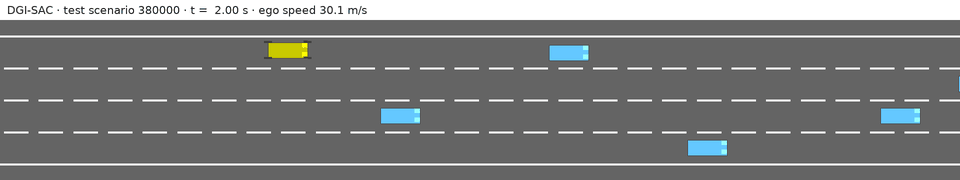

# DGI-SAC: Dynamic Graph Interaction Soft Actor-Critic for Lane-Changing Decisions

Code for the paper **Dynamic Graph Interaction Soft Actor-Critic for Lane-Changing Decisions:
Safety–Efficiency Trade-offs and Training Failure Modes** (Lingli Yu, Zexian He, Keyi Li; School of
Automation, Central South University).

Trained models, evaluation records, training logs and the scripts that
regenerate the paper's tables and figures: [ZENODO_DOI]

<p align="center">
  
  <br><em>DGI-SAC (yellow) overtaking in held-out test scenario 380000, an excerpt from the episode of Fig. 3 (real time).</em>
</p>

## Method

DGI-SAC extends soft actor-critic (SAC) with an actor that combines a flattened branch and a graph branch, concatenating and fusing their outputs before the Gaussian policy head while retaining the standard SAC critics.

The task is `highway-fast-v0` in [highway-env](https://github.com/Farama-Foundation/HighwayEnv) 1.10.2: four lanes, 30 surrounding vehicles, continuous acceleration and steering at 5 Hz, a 40 s episode limit. Leaving the road ends the episode with the collision penalty.

## Installation

Use Python 3.12.

```bash
git clone https://github.com/Hezexian/dgi-sac-lane-change.git dgi-sac-lane-change
cd dgi-sac-lane-change
python -m venv .venv
```

Activate the virtual environment with the command for your system.

Linux/macOS:

```bash
source .venv/bin/activate
```

Windows PowerShell:

```powershell
.\.venv\Scripts\Activate.ps1
```
For GPU training, install a CUDA-enabled build of PyTorch 2.8.0 before installing the dependencies below.

Install dependencies and optionally run the tests:

```bash
python -m pip install -r requirements.txt
python -m pytest tests  # optional
```

## Train

The config file selects the method:

| Config                   | Method                       | Code                              |
| ------------------------ | ---------------------------- | --------------------------------- |
| `configs/dgi_sac.yaml` | **DGI-SAC (proposed)** | `dgi_sac/algorithms/dgi_sac.py` |
| `configs/sac.yaml`     | SAC                          | `dgi_sac/algorithms/sac.py`     |
| `configs/mlp.yaml`     | Capacity-matched MLP         | `dgi_sac/algorithms/mlp.py`     |
| `configs/td3.yaml`     | TD3                          | `dgi_sac/algorithms/td3.py`     |
| `configs/ddpg.yaml`    | DDPG                         | `dgi_sac/algorithms/ddpg.py`    |

DGI-SAC, SAC, and the capacity-matched MLP share the SAC update and differ only in actor architecture. All methods share the environment, replay buffer, training loop, and evaluation code.

```bash
python train.py --config configs/dgi_sac.yaml --seed 26093001
python train.py --config configs/sac.yaml --seed 26093001 --set train.total_steps=50000
python train.py --config configs/dgi_sac.yaml --seed 26093001 --set train.td_target_clip=auto --output runs/dgi_sac_clip_seed26093001
```

`td_target_clip=auto` enables TD-target clipping for DGI-SAC, SAC, and the capacity-matched MLP (Section 4.4).

Results go to `runs/<method>_seed<seed>/`: `validation.csv` (unsafe rate, success rate and mean speed every
25,000 steps), `losses.csv`, `episodes.csv`, checkpoints and `final.pt`.

```bash
python scripts/plot.py runs/dgi_sac_seed26093001 runs/sac_seed26093001     # validation curves -> curves.png
```

## Evaluate and record videos

```bash
python evaluate.py --checkpoint runs/dgi_sac_seed26093001/final.pt --episodes 1000
python scripts/record_video.py --checkpoint runs/dgi_sac_seed26093001/final.pt --scenario 380000
```

To use the paper’s trained models, download and extract `dgi-sac-lane-change-models.zip` from [ZENODO_DOI]. Select a method and paper seed (1–15 for DGI-SAC, SAC, and MLP, or 1–10 for TD3 and DDPG). For example, `--seed 2` selects paper seed 002, corresponding to training seed 26093002.

```bash
python evaluate.py --method dgi_sac --seed 2 --models-dir <extracted>/models
python evaluate.py --method dgi_sac --seed 2 --models-dir <extracted>/models --ablation cut_ego_edges   # Section 4.3
python scripts/record_video.py --method dgi_sac --seed 2 --models-dir <extracted>/models --scenario 380000
```

By default, evaluation uses test scenario seeds 380000–380999. Use `--scenarios screening` for seeds 350000–350999. Evaluation outputs are saved under `results/`, and videos under `videos/`. Add `--trajectories` to save per-step trajectories.

## Citation

```bibtex
@article{yu2026dgisac,
  title  = {Dynamic Graph Interaction Soft Actor-Critic for Lane-Changing Decisions: Safety--Efficiency Trade-offs and Training Failure Modes},
  author = {Yu, Lingli and He, Zexian and Li, Keyi},
  year   = {2026},
  note   = {Manuscript under review}
}
```

## License

MIT (see [LICENSE](LICENSE)). The SAC implementation derives from
[pranz24/pytorch-soft-actor-critic](https://github.com/pranz24/pytorch-soft-actor-critic) (MIT).
Data, models and videos on Zenodo are released under CC BY 4.0.
